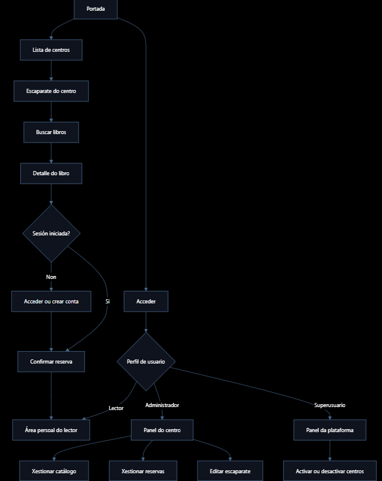
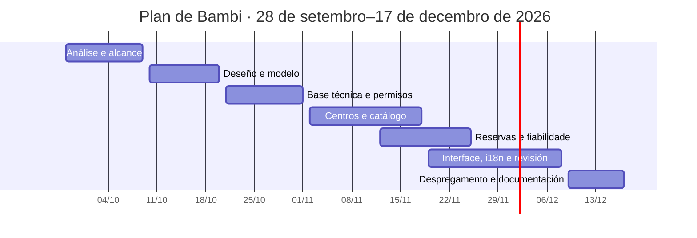

# Bambi

## Índice

- [Descrición do proxecto](#descrición-do-proxecto)
- [Propósito](#propósito)
- [Análise](#análise)
  - [Estado da arte ou análise do contexto](#estado-da-arte-ou-análise-do-contexto)
  - [Obxectivos](#obxectivos)
  - [Alcance](#alcance)
  - [Xustificación do proxecto e estudo de necesidades](#xustificación-do-proxecto-e-estudo-de-necesidades)
  - [Funcionalidades](#funcionalidades)
  - [Tipos de usuarios](#tipos-de-usuarios)
  - [Modelo de negocio](#modelo-de-negocio)
  - [Normativa](#normativa)
- [Deseño](#deseño)
  - [Casos de Uso](#casos-de-uso)
  - [Navegación de ventás](#navegación-de-ventás)
  - [Base de Datos](#base-de-datos)
- [Planificación da solución técnica](#planificación-da-solución-técnica)
  - [Identificación de fases](#identificación-de-fases)
  - [Identificación de recursos](#identificación-de-recursos)
  - [Planificación temporal](#planificación-temporal)
  - [Orzamento](#orzamento)
- [Codificación e probas](#codificación-e-probas)
  - [Prototipos realizados](#prototipos-realizados)
- [Conclusións](#conclusións)
- [Referencias, fontes consultadas e recursos externos](#referencias-fontes-consultadas-e-recursos-externos)

## Descrición do proxecto

Bambi (Books, Archives, Media & Bibliographic Information) é unha aplicación web multicliente para que librerías independentes e bibliotecas pequenas publiquen un escaparate dixital propio. Cada centro contará cunha páxina pública coa súa identidade visual, descrición, localización e catálogo. Os lectores poderán consultar a dispoñibilidade e reservar exemplares para recollelos presencialmente: como préstamo nunha biblioteca ou como compra presencial nunha libraría. A plataforma non procesa pagos nin envía libros.

A aplicación contempla tres perfís: superusuario da plataforma, administrador dun centro e lector. Os administradores manterán os datos do seu centro, catálogo e reservas. O superusuario dará de alta e baixa centros. Mentras que os lectores buscarán libros e xestionarán as súas reservas. Haberá un sistema de fiabilidade que poderá penalizar reservas non recollidas mediante puntos e un bloqueo temporal seguindo unhas reglas. A interface estará dispoñible en galego, castelán e inglés. Así este documento contempla a planificación previa, antes da implementación das funcionalidades.

## Propósito

O propósito principal de Bambi é ofrecer ás librarías independentes e ás bibliotecas pequenas un escaparate dixital personalizable onde os lectores poidan consultar o catálogo e reservar libros para recollelos presencialmente. A solución busca facilitar a presenza en Internet destes centros mediante unha plataforma sinxela e de baixo custo, dispoñible en galego, castelán e inglés.

## Análise

### Estado da arte ou análise do contexto

A aplicación vai destinada a librerías independentes e bibliotecas pequenas (tipo bibliotecas municipais,
escolares, dunha asociación…) sen orzamento para unha web propia. Tamén a lectores que queren saber
se un libro está dispoñible antes de desprazarse.
Así, principalmente, vai dar visibilidade en internet aos centros pequenos, pois permite que os lectores
consulten sen ningún custo (só no caso das librerías habería que pagar segundo o número de visitas).
Actualmente non hai ningún proxecto que de forma case totalmente libre permita expoñer o catálogo ás
bibliotecas senón que cada unha ten a súa propia web propia, o máis parecido que atopamos é o proxecto
“Todos tus libros” de CEGAL que permite a librerías asociadas iso mesmo, pero que segue sen dar unha
solución de interface personalizada. Ademais de que precisa esa asociación con CEGAL. No noso caso só
precisaremos dalgún documento que exprese a existencia de esa librería/biblioteca para proceder ca súa
alta no proxecto.
Por outro lado, obviamente, existen tendas online de venta de libros, pero eso quita o valor propio deste
proxecto que é achegar as tendas físicas ao mundo virtual.
Así, poderíamos dicir que ningunha solución xa existente reúne librerías e bibliotecas pequenas nunha
plataforma barata como a plantexada, que ademais conta cun escaparate personalizable e coa posibilidade
de reservas para recoller en persoa os libros.
Polo tanto, podemos afirmar que existe unha oportunidade de negocio, xa que as bibliotecas usarán a
plataforma gratis mentras que as librerías só pagarán segundo as visitas recibidas, é dicir segundo o
beneficio obtido mediante o uso da plataforma Bambi.

### Obxectivos

#### Obxectivo xeral

Construír un prototipo web multicliente, accesible e trilingüe que permita a pequenos centros culturais amosar o seu catálogo e xestionar reservas para recollida presencial.

#### Obxectivos específicos

De forma máis detallada estas serán as distintas funcionalidades que se teñen por obxectivo implementar:

1. Tres tipos de usuarios con diferentes permisos (superusuario, administrador de centro e lector).
2. Permitir ao superusuario dar de alta e de baixa centros.
3. Visualización da landing page do proxecto e o escaparate de cada centro nos tres idiomas.
4. Permitir ao administrador de centro personalizar o seu escaparate. É dicir, o logo, cores, tipografía, descrición e localización.
5. Permitir ao administrador de centro xestionar o catálogo do seu centro. O que inclúe alta, baixa, modificación e cambio dos estados dun libro.
6. Permitir a un lector darse de alta e reservar libros nos diferentes escaparates dos centros.
7. Permitir buscar un determinado libro nun centro tanto sexa por título, por ISBN ou autor/a.
8. Sistema de login para os diferentes roles, así como páxinas diferenciadas.
9. Xestionar as reservas con caducidade automática e cancelación.
10. Un sistema de puntos de fiabilidade e a posibilidade dun bloqueo temporal para un usuario lector.
11. Contar as visitas de cada escaparate.
12. Unha interface responsive e accesible.

### Alcance

#### Incluído no prototipo

- Aplicación monolítica Django con base de datos relacional compartida e separación lóxica dos datos por centro.
- Escaparate público por libraría ou biblioteca, con marca básica, descrición e localización.
- Catálogo con título, autoría, ISBN opcional, descrición opcional e estado de dispoñibilidade.
- Busca por título, autor/a e ISBN.
- Alta e acceso de usuarios, permisos por rol e páxinas de xestión.
- Reserva, cancelación, caducidade e actualización manual do estado de recollida/prestado.
- Puntos e bloqueo temporal segundo unhas reglas.
- Contador de visitas por escaparate.
- Interface responsive e tradución da interface a tres idiomas.
- Datos de demostración e despregamento de avaliación.

#### Fóra do alcance

- Pago, compra en liña, facturación de vendas ou envío a domicilio.
- Integración con sistemas bibliotecarios ou API de terceiros.
- Notificacións por correo/SMS
- Autenticación multifactor.
- Bases de datos independentes por centro. A separación será lóxica e obrigatoria en cada consulta.
- Aplicación móbil nativa, recomendacións algorítmicas ou importación masiva avanzada.
- Explotación comercial real ou tratamento de datos de persoas reais no prototipo.

O período académico previsto remata en decembro de 2026 e o equipo de implementación é unha persoa. Por iso, o resultado considérase un prototipo funcional e non un servizo comercial listo para operar. Antes de aceptar centros reais habería que completar revisión de seguridade e privacidade.

### Xustificación do proxecto e estudo de necesidades

Bambi xorde da dificultade que poden ter as librerías independentes e as bibliotecas pequenas para manter unha páxina web propia e ofrecer información actualizada sobre os seus fondos. Sen un catálogo dixital, os lectores poden ter que desprazarse ou contactar co centro para saber se un libro está dispoñible. Un escaparate común e personalizable pretende reducir esa barreira e facilitar o acceso á oferta cultural local.

O proxecto responde a catro necesidades principais: dar visibilidade en Internet aos centros pequenos; permitirlles publicar e actualizar o catálogo sen desenvolver unha web desde cero; axudar aos lectores a localizar libros e comprobar a súa dispoñibilidade; e xestionar reservas para recollida presencial, mantendo a compra ou o préstamo baixo control do propio centro. A interface en galego, castelán e inglés amplía a accesibilidade lingüística, e a separación dos permisos permite que cada centro administre só os seus datos.

O anteproxecto sinala como alternativas «Todos tus libros», de CEGAL, as tendas en liña e as webs propias de cada centro. A proposta de Bambi diferénciase por combinar librerías e bibliotecas pequenas, ofrecer escaparates personalizables e priorizar a reserva presencial.

### Funcionalidades

| ID  | Funcionalidade                               | Actor(es)                           | Resultado / criterio de aceptación                                                                           |
| --- | -------------------------------------------- | ----------------------------------- | ------------------------------------------------------------------------------------------------------------ |
| F01 | Consultar a portada e os escaparates         | Visitante, lector                   | O catálogo e os datos públicos poden consultarse sen iniciar sesión                                          |
| F02 | Cambiar idioma                               | Visitante, lector, administrador    | Interface dispoñible en gl, es e en; os contidos do centro poden requirir tradución propia                   |
| F03 | Dar de alta, activar ou desactivar un centro | Superusuario                        | Un centro só aparece publicamente despois da súa activación                                                  |
| F04 | Personalizar escaparate                      | Administrador de centro             | Pode editar logotipo, cores, tipografía dispoñible, descrición e localización do seu centro                  |
| F05 | Xestionar catálogo                           | Administrador de centro             | Pode crear, editar, retirar e cambiar o estado dos libros do seu centro                                      |
| F06 | Buscar libros                                | Visitante, lector                   | A busca acepta título, autor/a ou ISBN e amosa centro e dispoñibilidade                                      |
| F07 | Crear conta e iniciar sesión                 | Lector, administrador, superusuario | Cada perfil accede ás vistas e accións autorizadas                                                           |
| F08 | Reservar un exemplar dispoñible              | Lector                              | Reserva ligada ao centro e exemplar; impídese reservar se non hai dispoñibilidade ou o lector está bloqueado |
| F09 | Cancelar e consultar reservas                | Lector                              | Só pode cancelar e consultar as súas propias reservas activas e históricas                                   |
| F10 | Xestionar reservas                           | Administrador de centro             | Pode marcar recollida/préstamo, non recollida e devolución cando proceda                                     |
| F11 | Aplicar caducidade e fiabilidade             | Sistema, administrador, lector      | A reserva caduca segundo prazo configurado; unha non recollida actualiza puntos e bloqueo de forma auditable |
| F12 | Contabilizar visitas                         | Sistema, administrador              | Amósanse métricas agregadas; non se usa para perfilar visitantes                                             |

### Tipos de usuarios

| Actor/perfil            | Obxectivo                                       | Permisos principais                                                                                                |
| ----------------------- | ----------------------------------------------- | ------------------------------------------------------------------------------------------------------------------ |
| Visitante               | Descubrir centros e libros                      | Consultar escaparates e catálogos públicos, buscar; sen reservar                                                   |
| Lector                  | Reservar libros e controlar as súas solicitudes | Crear conta, reservar, cancelar as súas reservas, ver historial e puntos                                           |
| Administrador de centro | Manter a presenza e operación do seu centro     | Editar escaparate e catálogo propio; xestionar reservas do seu centro; marcar recollida, non recollida ou préstamo |
| Superusuario            | Administrar a plataforma                        | Verificar, activar e desactivar centros e asignar o primeiro administrador                                         |

### Modelo de negocio

O modelo proposto combina acceso gratuíto para bibliotecas e unha tarifa para librarías vinculada ás visitas recibidas. A tarifa exacta, o período de cómputo, a definición de visita válida, os límites e a facturación non están determinados no anteproxecto. O prototipo só medirá visitas agregadas e non cobrará nin emitirá facturas.

| Segmento                | Proposta de valor                                                   | Ingresos / custo                                                                                |
| ----------------------- | ------------------------------------------------------------------- | ----------------------------------------------------------------------------------------------- |
| Bibliotecas pequenas    | Escaparate e reservas sen custo de licenza previsto                 | Uso gratuíto; custo asumido pola plataforma ou por futuras axudas                               |
| Librarías independentes | Visibilidade local, catálogo consultable e solicitudes de recollida | Tarifa futura proporcional a visitas válidas; importe por definir tras validar custos e mercado |
| Lectores                | Consulta de dispoñibilidade e reserva para recollida próxima        | Gratuíto; a recollida e o pago, se existe, fanse no centro                                      |

### Normativa

Esta sección identifica normativa aplicable ao uso da plataforma en España e Galicia.

#### Protección de datos

Se Bambi chega a funcionar con persoas reais, terá que cumprir o RGPD e a Lei orgánica de protección de datos. Pedirá só os datos necesarios para crear unha conta e xestionar reservas, explicará para que os usa e durante canto tempo os conserva, e permitirá ás persoas usuarias exercer os seus dereitos.

Os datos deberán protexerse con contrasinais seguros, acceso limitado e copias de seguridade protexidas. Antes de ofrecer o servizo, haberá que deixar claro se os datos os xestiona cada centro, a plataforma ou ambas partes. O prototipo académico empregarase con datos ficticios.

#### Obrigas fiscais e comerciais

Se Bambi se converte nun servizo comercial, haberá que dar de alta a actividade e cumprir coas obrigas fiscais que correspondan, como declarar os ingresos e emitir facturas. Tamén haberá que informar quen ofrece o servizo e publicar as súas condicións. Pero de momento o prototipo non cobrará nin emitirá facturas.

#### Obrigas laborais e prevención

Nesta fase académica, o proxecto desenvolvese só por unha persoa e non está prevista a contratación de persoal. Polo tanto, non se xestionarán contratos, nóminas nin cotizacións. Para coidar a saúde durante o desenvolvemento, sempre se intentará manter unha postura adecuada, facer pausas e organizar o uso das pantallas. Se no futuro Bambi se converte nunha actividade profesional ou se incorpora persoal, haberá que revisar e cumprir as obrigas laborais e de prevención que correspondan nese momento.

## Deseño

Este deseño describe a arquitectura prevista para o prototipo académico. As decisións son propostas técnicas que se poderán axustar durante a implementación; non implican que a aplicación estea xa construída.

### Arquitectura

Nesta plataforma o navegador envía solicitudes HTTPS a Django, que renderiza as páxinas, comproba os permisos, aplica as regras do sistema e consulta a base de datos. As tarefas de caducidade de reservas executaríanse cun comando programado de Django; non se precisan microservizos nin unha cola de mensaxes para o prototipo.

| Compoñente               | Tecnoloxía prevista                      | Función                                                            |
| ------------------------ | ---------------------------------------- | ------------------------------------------------------------------ |
| Interface web            | HTML, plantillas Django, Bootstrap e CSS | Amosar os escaparates e os paneis adaptados a móbiles e escritorio |
| Servidor da aplicación   | Python e Django                          | Xestionar sesións, permisos, buscas, catálogo e reservas           |
| Base de datos local      | SQLite                                   | Gardar os datos durante o desenvolvemento                          |
| Base de datos despregada | PostgreSQL                               | Gardar de forma persistente os datos do prototipo despregado       |
| Tarefa programada        | Comando de xestión de Django             | Caducar reservas cando venza o prazo                               |

O fluxo técnico é: **navegador → HTTPS → aplicación Django → ORM de Django → base de datos**. A resposta volve á interface como unha páxina HTML. A tarefa programada consulta e actualiza as reservas vencidas.

### Casos de Uso

| Actor                   | Accións dispoñibles                                                                 |
| ----------------------- | ----------------------------------------------------------------------------------- |
| Visitante               | Consultar escaparates e catálogos públicos; buscar libros                           |
| Lector                  | Crear conta e acceder; reservar ou cancelar; consultar historial e puntos           |
| Administrador de centro | Editar o escaparate; xestionar o catálogo e as reservas do seu centro               |
| Superusuario            | Dar de alta, activar e desactivar centros                                           |
| Sistema                 | Caducar reservas, aplicar as regras de fiabilidade e contabilizar visitas agregadas |

**Reserva:** o lector autenticado busca un libro, selecciona un centro e solicita un exemplar dispoñible. O servidor verifica o rol, o estado de bloqueo, a dispoñibilidade e a pertenza do exemplar ao centro; crea a reserva e actualiza a dispoñibilidade nunha operación atómica. O lector recibe confirmación co prazo e as instrucións de recollida.

**Recollida ou non recollida:** o administrador consulta as reservas do seu centro e marca a recollida/préstamo ou a non recollida. Ao chegar a data límite, o proceso de caducidade pecha a reserva. A aplicación aplica a regra de puntos definida, garda o motivo e libera o exemplar cando corresponda.

**Alta de centro:** o superusuario revisa a solicitude ou documentación que acredite a existencia do centro, crea o centro e asigna un administrador. O escaparate faise público tras a activación.

### Base de Datos

| Entidade          | Campos principais                                                                         | Relacións e regras                                                                         |
| ----------------- | ----------------------------------------------------------------------------------------- | ------------------------------------------------------------------------------------------ |
| Centro            | id, nome, tipo (libraría/biblioteca), slug, descrición, localización, logo, cores, estado | Ten usuarios administradores, libros e reservas                                            |
| Usuario           | id, nome visible, correo, hash de contrasinal, idioma, activo                             | Autenticación Django; rol por grupo/permisos; un administrador asociado a un centro        |
| Libro/Exemplar    | id, centro_id, título, autoría, ISBN, descrición, estado                                  | Pertence a un centro; ISBN non necesariamente único globalmente; estado de dispoñibilidade |
| Reserva           | id, lector_id, exemplar_id, creado_en, vence_en, estado, puntos_aplicados                 | Pertence a un lector e exemplar; conserva transicións relevantes                           |
| EventoFiabilidade | id, lector_id, reserva_id, cambio, motivo, creado_en, actor_id                            | Historial auditable de cambios de puntos e bloqueos                                        |
| Visita agregada   | id, centro_id, día, total                                                                 | Conta diaria por centro, sen almacenar IP ou identificador persistente no deseño inicial   |

As relacións entre as entidades son:

- Un **centro** pode ter varios administradores, exemplares e rexistros diarios de visitas.
- A relación entre **usuarios administradores e centros** gárdase en `USUARIO_CENTRO`, polo que un centro pode ter máis dun administrador.
- Un **usuario lector** pode crear varias reservas; cada reserva corresponde a un exemplar.
- Un **exemplar** pertence a un único centro e pode aparecer en distintas reservas ao longo do tempo, pero non debe ter dúas reservas activas á vez.
- Unha **reserva** pode xerar eventos de fiabilidade; cada evento indica o lector afectado, a reserva, o cambio aplicado e quen rexistrou a acción.

### Navegación de ventás

O percorrido principal da interface é:

1. A persoa visitante entra na portada e busca un libro ou escolle un centro.
2. Desde o escaparate abre a ficha dun libro e consulta a súa dispoñibilidade.
3. Para reservar, inicia sesión ou crea unha conta e confirma a solicitude.
4. Na súa área persoal consulta o prazo, o estado, o historial e os puntos.
5. O administrador accede ao panel do seu centro para editar o escaparate, actualizar o catálogo e atender as reservas.
6. O superusuario accede ao panel xeral para revisar e xestionar as altas dos centros.

| Pantalla                | Contido principal                                              | Perfil                  |
| ----------------------- | -------------------------------------------------------------- | ----------------------- |
| Portada                 | Presentación de Bambi, busca e acceso á lista de centros       | Visitante, lector       |
| Escaparate              | Identidade do centro, localización, busca e libros dispoñibles | Visitante, lector       |
| Detalle do libro        | Información bibliográfica, centro e dispoñibilidade            | Visitante, lector       |
| Confirmación de reserva | Resumo do libro, centro de recollida e prazo                   | Lector                  |
| Área persoal            | Reservas activas e anteriores, estado e puntos                 | Lector                  |
| Panel do centro         | Escaparate, catálogo e reservas                                | Administrador de centro |
| Panel da plataforma     | Centros pendentes, activos e desactivados                      | Superusuario            |

## Planificación da solución técnica

### Identificación de fases

| Fase                             | Actividades                                                                                       | Entregable                                   |
| -------------------------------- | ------------------------------------------------------------------------------------------------- | -------------------------------------------- |
| 1. Análise e peche de alcance    | Revisar requisitos, perfís, regras de reserva e prioridades; validar con titoría                  | Análise e criterios de aceptación            |
| 2. Deseño                        | Arquitectura, modelo de datos, fluxos e bocetos de pantallas                                      | Especificación técnica e pantallas descritas |
| 3. Base técnica                  | Crear proxecto Django, configuración local, PostgreSQL de despregamento, autenticación e permisos | Aplicación base executándose                 |
| 4. Funcionalidades centrais      | Centros, escaparates, catálogo, busca e separación por centro                                     | Catálogo público e panel de centro           |
| 5. Reservas                      | Crear/cancelar, estados, caducidade, puntos e métricas agregadas                                  | Fluxo completo de reserva                    |
| 6. Interface e calidade          | Responsive, accesibilidade básica, traducións, revisión de permisos e erros                       | Versión candidata con datos ficticios        |
| 7. Despregamento e documentación | Configurar entorno de demostración, carga de datos, guía de uso e memoria                         | Prototipo despregado e documentación final   |

### Identificación de recursos

**Humanos**

- Unha persoa desenvolvedora (análise, programación, documentación e despregamento).
- Titor do proxecto: revisión de alcance e entregables en reunións periódicas.
- Persoas alleas ao proxecto para verificar que a plataforma sexa intuitiva e usable.

**Materiais e software**

- Ordenador persoal e conexión a Internet xa dispoñibles.
- Python, Django, SQLite, PostgreSQL, Bootstrap, VS Code e Git.
- Servizo de aloxamento de baixo custo para a demostración e dominio.
- Copias de seguridade e base de datos con datos ficticios.

### Planificación temporal

O proxecto comeza o **28 de setembro de 2026**, durante a última semana dese mes. A primeira fase remata o **9 de outubro** e a segunda o **20 de outubro**. A entrega final está prevista para o **17 de decembro de 2026**.

| Fase                               | Inicio     | Fin            | Hito                             |
| ---------------------------------- | ---------- | -------------- | -------------------------------- |
| 1. Análise e peche do alcance      | 28/09/2026 | **09/10/2026** | Análise aprobada                 |
| 2. Deseño da solución              | 10/10/2026 | **20/10/2026** | Deseño e especificación pechados |
| 3. Base técnica e permisos         | 21/10/2026 | 01/11/2026     | Aplicación base preparada        |
| 4. Centros, escaparates e catálogo | 02/11/2026 | 18/11/2026     | Catálogo e panel de centro       |
| 5. Reservas e fiabilidade          | 12/11/2026 | 25/11/2026     | Fluxo de reserva completo        |
| 6. Interface, idiomas e revisión   | 19/11/2026 | 08/12/2026     | Versión candidata revisada       |
| 7. Despregamento e documentación   | 09/12/2026 | **17/12/2026** | Entrega final                    |

O calendario é orientativo e concentraríase a parte máis técnica no mes de novembro.

### Orzamento

| Concepto                     |            Cálculo |  Estimación |
| ---------------------------- | -----------------: | ----------: |
| Desenvolvemento individual   |     200 h × 15 €/h |     3.000 € |
| Aloxamento de demostración   | 4 meses × 10 €/mes |        40 € |
| Dominio                      |  1 ano, estimación |        15 € |
| **Total económico estimado** |                    | **3.055 €** |

Esta é unha estimación do valor do traballo: as **200 horas** equivalen a **50 xornadas de 4 horas**. Como desenvolvo eu o proxecto, os **3.000 €** de man de obra non son un gasto que vaia pagar. O desembolso real previsto sería de **55 €**: 40 € polo aloxamento e 15 € polo dominio. O ordenador e a conexión xa están dispoñibles e non supoñen un custo adicional.

## Codificación e probas

### Prototipos realizados

#### Prototipo 1

**Data:** 3 de novembro de 2026

**Descrición:** primeira versión funcional de Bambi, unha aplicación Django con plantillas e Bootstrap, publicada en PythonAnywhere con datos ficticios en <https://a22dianart.pythonanywhere.com>. Inclúe o percorrido principal: o lector atopa un libro e resérvao, e o centro xestiona o seu catálogo e as súas reservas. Nesta versión a base de datos despregada é SQLite. O código conta con 67 probas automáticas de Django, que se superan todas. Quedan pendentes a caducidade automática das reservas, os puntos e o bloqueo por fiabilidade, e o contador de visitas.

**Funcionalidades implementadas:**

- **Portada e escaparates públicos:** consulta sen iniciar sesión dos centros activos e dos seus catálogos, coa identidade visual de cada centro.
- **Idiomas:** interface en galego, castelán e inglés.
- **Contas e permisos:** rexistro de lectores, inicio e peche de sesión e acceso segundo o rol (lector, administrador de centro ou superusuario).
- **Xestión da plataforma:** o superusuario crea centros, cambia o seu estado e xestiona os seus administradores.
- **Personalización do escaparate:** o administrador edita nome, descrición, localización, logotipo, cores, tipografía e días de reserva.
- **Xestión do catálogo:** o administrador crea, edita, retira e cambia o estado dos exemplares do seu centro.
- **Busca:** por título, autoría ou ISBN, co centro e a dispoñibilidade de cada exemplar.
- **Reservas do lector:** reserva de exemplares dispoñibles, consulta da área persoal e cancelación durante os 5 minutos seguintes a facer a reserva.
- **Reservas do centro:** o administrador marca cada reserva como recollida ou non recollida e, nas bibliotecas, rexistra a devolución.
- **Datos de demostración:** comando `cargar_demo` para crear centros, libros, usuarios e reservas ficticios.

## Conclusións

Como se recolle neste documento, nun prazo aproximado de tres meses está previsto deseñar e desenvolver un prototipo web para que librerías e bibliotecas pequenas poidan amosar os seus catálogos e ofrecer reservas presenciais. A proposta concreta os perfís de usuario, as funcionalidades, a arquitectura técnica e as fases necesarias para construír unha plataforma multicliente e trilingüe.

O prototipo previsto permitirá comprobar se Bambi pode facilitar a visibilidade dos centros e axudar aos lectores a atopar libros dispoñibles na súa contorna. Unha vez rematado o desenvolvemento, estas conclusións deberán completarse cos resultados obtidos, as funcionalidades realmente implementadas e as aprendizaxes do proceso.

## Referencias, fontes consultadas e recursos externos

- [AEPD: cumprir os deberes de protección de datos](https://www.aepd.es/en/rights-and-duties/fulfill-your-duties).
